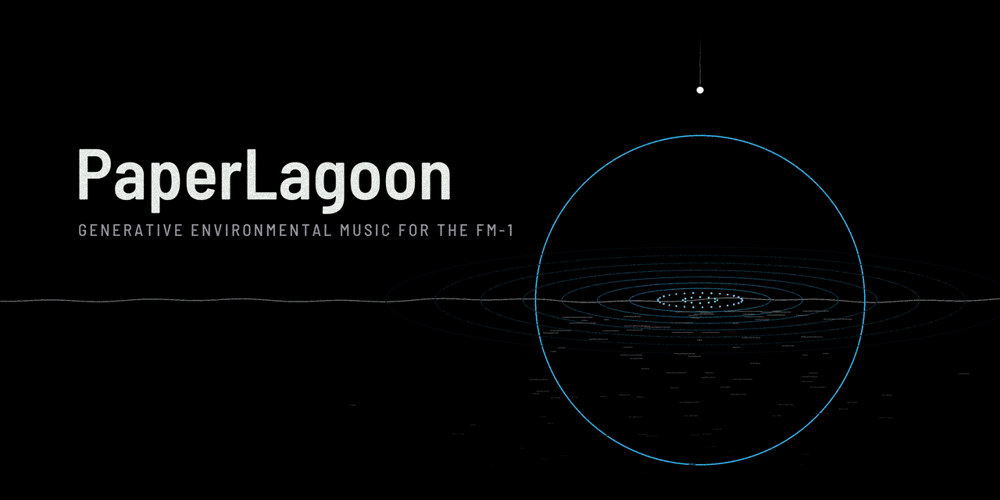

# PaperLagoon



A generative environmental-music firmware for the M-VAVE FM-1. It plays by itself; you steer it from outside.

FM voices through AMB-1's tape echo and plate, played in seven worlds that a hidden state leans. The manual:
[app/docs/MANUAL.md](app/docs/MANUAL.md) (日本語: [app/docs/MANUAL.ja.md](app/docs/MANUAL.ja.md)); the site, to try it in
the browser and install it: https://hacha.github.io/paperlagoon/

It reads nothing another firmware saved (projects, presets, samples), and that may not be there when you go back to
it: back it up first.

## Controls

| Control | Does |
|---|---|
| SELECT | turns through the pages: 1 the lagoon, 2..4 the kit's voices, 5 the effects, 6 the age, 7 the environment, 8 the cycles, 9 the chords, 10 the pulse, 11 the memory, 12 global (as HYP-1: on the rule over the knobs, the page's name and a short bar a page, the one shown lit; the header keeps the world) |
| HOME | the lagoon (lit there) |
| EDIT | the voices (lit there); again: the next voice; held: the voice as the kit has it |
| FX | the effects: K1..K4 Time (the tape's loop), Feedback, Size (the plate), Wear (the tape's age; it blurs the whole sound too: a late, wandering copy). Again: the age: K1..K4 Haze (the band narrows, the loud parts round off), Hiss (a breathing floor of noise, while it plays), Dropout (the sound thins now and then, darker, as worn tape), Air (the voices' breath, times 0..2: 50 as the kit has it); again: back |
| ENV | the environment: the world, its root, beat and scale; K1..K4 Drift (how far the cycles and offerings sway the music), Offer, Tempo, Transpose |
| LFO | the cycles (breath, tide, long turn) as orbits: K1..K3 their depths, K4 Pace |
| GLO | global: K1..K4 Tune, Level, Lights (the buttons' glow), Sleep (minutes; its last minute is a dusk, sparser, quieter, a little slower; then it rests) |
| ARP | the chords: broken chords under the music, in the low voice's colour, each world walking the chord its own way; K1..K4 Level (0: none), Stir (the notes' grain, as the world leans it; sparse rings long), Spread (how wide: light reaches higher, a fold draws it in), Wander (how far the walk and its grain move with the music: 0 the world's own). Again: the pulse, a muffled beat (a low thump, a small click, a brush) on each world's own patterns (some worlds leave one or two out); K1..K4 Level (0: none), Stir (hits taken or added), Wander (how far the patterns move with the music: 0 still), Weight (the thump against the click and the brush). Again: back. Both keep the music's silences (in a long rest they fade, in some worlds wholly) and never cut a sounding note. A hazy pulse at most, never a dance |
| OCT- / OCT+ | the music's register, two octaves either way |
| REC | held: the keys play (the music waits); let go: the phrase is taken in as the music's own, as the world holds it. OCT- / OCT+ meanwhile move the keys' octave |
| SEL | held: K1..K4 are the lagoon's four from any page (on the lagoon itself, in finer steps) |
| SEQ | the memory: what the music holds (a motif, a chord, a line, a figure: as the world has it); K1..K4 Repeat (the times before it may change), Change (how much), Length, Memory (how often an older one comes back). Held: hold it (nothing new taken up, the scale kept), held again: let go |
| PRESETS | the kit: ten sets of three voices (lead, answer, low); edits are kept per kit |
| ALGORITHM | the world: seven places that exist nowhere, each its own way of making music (never the knobs nor the kit). Chosen at once, reached by a crossing: the music finishes its phrase where it is (a few seconds; the header says CROSSING, the name breathing, a wake running under it), the chords and the pulse fading, then a breath, and the new world opens |
| K1..K4 | the lagoon: Density, Bright, Space, Echo. A voice: Color, Bright, Decay, Soft |
| PLAY | plays or rests. It opens: sparse at first, full in some 25 s, the chords and the pulse coming in a few bars later. A rest is at once (the echoes and the plate ring on) |
| SAVE | keeps all of it (lit when something is not saved) |

Every button glows dim; the one whose page shows is lit, and so are PLAY when playing, SAVE when unsaved, SEQ when held, ARP when the chords or the pulse sound, OCT when moved.

| Keys | play no notes (but under REC): a press *offers* something to a hidden state (held: a little more, again and again). When its drop meets the water the offering splashes: the sound stirs at once (smeared, darker or opener, the echoes and the plate swelling, hushed or swollen), the music answers soon, and in a second or two it is gone; then it seeps in slowly |

Kits: TIN HARBOR, WOODEN RAIN, GLASS ORCHARD, SLOW BREATH, IRON SNOW, HAZE ARCHIVE, DUST PIPES, FOG LANTERN, CHALK GARDEN, BRASS EVENING.
Some voices have breath (air beside the tone, a rough modulation, a pitch that wanders: worn, hazy), fixed by the kit
(a little in SLOW BREATH and HAZE ARCHIVE, much in DUST PIPES, FOG LANTERN and CHALK GARDEN), scaled by Air (FX, again); a voice's
page shows it.

Worlds, each its own way of making music and its own scales, a darker to a brighter (heard at once; the screen changes with it):
SHALLOWS OF MEMORY (a motif written in a note or two each pass until whole, heard whole, then faded a note or two each pass until nothing is left; a silence, another), BEHIND THE HORIZON (a drone: chords that swell and fall
back, a low tone under them, now and then one note of a melody), THE UNREAD LETTER (single points, far apart: a few
pitches, the letter's words, each a leap from the last, at uneven distances; a long silence after each line; in the
margin some stay unread), THE FOUNTAIN AFTER CLOSING (one figure that rises and falls back, round and round in soft eighths,
changing a little now and then), WHERE LIGHT BECOMES MOSS (four loops of unequal length, drifting in and out of step), THE ATTIC OF LOOSE KEYS (five keys close together, high, struck in gusts of 2–10, neighbour knocking neighbour, rising and dying away; stillness between gusts, no beat; after a spell a longer calm, then a key changed or a new set hung; a strong gust may bring one deep tone), A STAIR AND ITS SHADOW (two voices, slowly: a walk by steps from a centre and back, each phrase one step longer, each note long; with every note its shadow, the nearest tone of the root's chord, under it or over, never the same pitch nor a semitone off; rests between, a long one after the longest, then the stair turns; the root low and long under each walk).

The music leans on four hidden quantities, named for paper (light, bleed, fold, margin; never shown), which three slow cycles of unequal length
(their lengths wander, about 50–100, 120–230 and 300–600 s) keep turning. An offering seeps into them over some seconds and fades over minutes; what it
changes (the scale, the register, the rests, the motifs' length, how often the answer and the low voice come, an
older motif folding back, a motif built on the offered pitch) is never one key to one thing. The screen answers at once: a drop falls to the water, rings spread.
The water's line is the state: higher in light, rougher when folded.

## Build

```sh
git submodule update --init --recursive
./build.sh --host                     # host simulator (a C compiler is enough)
./test.sh                             # every script in app/tests, judged by exit code (or: ./test.sh rec)
PL_LOG=f.log app/build/host/paperlagoon_host script.txt out/   # a log for long listens: each note, and each second's loudness, state, root, scale
./build.sh --web                      # browser emulator (Emscripten)
./serve.sh [port]                     # serve it on http://localhost:8000/
./site.sh X.Y PKG [--push]            # the site (app/build/site) from a release's package; --push: to gh-pages
./build.sh                            # device package (JieLi toolchain + AC79 SDK)
./install.sh [--build]                # install it on an FM-1 over USB (needs mido, python-rtmidi)
```

## Licence

GPL-3.0-only (see LICENSE). Built on [fm1-base](https://github.com/charlesvestal/fm1-base) (MPL-2.0) and
felucca-bsp. The plate and the echo come from AMB-1 (MPL-2.0); see LICENSING.md.
