# PaperLagoon

[English](https://github.com/hacha/paperlagoon/blob/main/app/docs/MANUAL.md)

PaperLagoon は、M-VAVE FM-1 のための、自動生成の環境音楽ファームウェアです。音楽はひとりで鳴ります。あなたは弾かずに、部屋の明かりを変えるように、
外から舵を取ります。FM の声がテープエコーとプレートを通り、フレーズの生成器がそれを奏で、その傾きは、
横からしか触れられない見えない状態が決めます。

---

## 目次

1. インストール
2. 画面
3. 操作
4. ページ
5. 鍵盤と捧げもの
6. 世界とキット
7. 縁
8. 保存
9. USB オーディオ
10. 困ったとき
11. ライセンス

---

## 1. インストール

まず試すなら、エミュレーターを開いてください。同じコードがブラウザで音つきで動きます。

ブラウザからインストールするには、Chrome か Edge を使います。FM-1 を USB でつなぎ、インストーラーを開いて
Install を押します。ブラウザが MIDI の許可を一度だけ尋ねるので、許可してください。書き込み中はケーブルを
抜かないでください。

ターミナルからは、ダウンロードしたバージョンのパッケージを使って
`python3 tools/fm1_install.py paperlagoon-VERSION.fwsc` を実行します。

インストールは自己責任です。M-VAVE 純正のファームウェアに戻すには、インストーラーの最後の項目を使います。
純正のものを書き戻します。

---

## 2. 画面

いちばん上がヘッダーです。世界の名前があります（ラグーンと声のページでは、近くにキットの名前も出ます）。世界が
移っている間は、右側とノブの上の線に CROSSING と出ます（「縁」を参照）。

いちばん下に4つのノブがあり、名前と値が出ます。その上に細い線（ルール）が走り、線の上に短い帯があります。
いま開いているページの名前と、ページごとの小さな棒の列で、開いているものが明るく光ります。12ページのどこに
いるかが分かります。SELECT を回すと順に巡り、ボタンを押すとそのページへ飛べます。

その間がページそのものです。水面、エンベロープ、輪、軌道。ページの主題を絵にしたもので、音楽につれて動きます。
音楽が休んでいるときは世界の名前が灰色になり、PLAY の光が鳴っているかどうかを示します。

ボタンはどれも暗く光っています。開いているページのボタンは明るく、PLAY は鳴っている間、SAVE は保存していない
ものがあるとき、SEQ は押している間、ARP はコードかパルスが鳴っているとき、OCT は音域を動かしたときに光ります。
光の強さは、全体のページの Lights で決めます。

---

## 3. 操作

| 操作 | 働き |
| --- | --- |
| SELECT | 12のページを順に巡ります。 |
| HOME | ラグーンへ。そこで光ります。 |
| EDIT | 声へ。もう一度押すと次の声。押し続けると、声がキットの元の音色に戻ります。 |
| FX | エフェクトへ。もう一度で AGE（かすれ）。もう一度で戻ります。 |
| ENV | 環境へ。世界、その主音、拍、音階。 |
| LFO | 周期へ。 |
| GLO | 全体のページへ。 |
| ARP | コードへ。もう一度でパルス。もう一度で戻ります。 |
| SEQ | 記憶へ。押し続けると音楽を留め、もう一度押し続けると手放します。 |
| OCT− · OCT+ | 音楽の音域を動かします。どちらへも2オクターブまで。REC を押している間は、鍵盤のオクターブを動かします。 |
| REC | 押している間、鍵盤が音になり、音楽は待ちます。離すと、弾いたフレーズが音楽自身のものとして取り込まれます。モチーフにはフレーズが丸ごと一度に書き込まれ、屋根裏の世界ではフレーズが鍵になります。 |
| SEL | 押している間、どのページでも K1〜K4 がラグーンの4つになります。ラグーンでは細かい刻みで回ります。 |
| PRESETS | キットを選びます。10、それぞれ3つの声。声の手直しはキットごとに残ります。 |
| ALGORITHM | 世界を選びます。7つ。切り替えは渡り（crossing）になります。 |
| K1〜K4 | 開いているページの4つのノブ。 |
| PLAY | 鳴らす、または休む。 |
| SAVE | すべてを保存します。保存していないものがあると光ります。 |
| 鍵盤 | 音は鳴らしません。押すと、音楽に何かを捧げます。 |

---

## 4. ページ

12あります。4つのノブはいつも開いているページのもので、書いてあるとおりに素直に効きます。見えない状態は
音楽の進み方を傾けますが、ノブそのものは決して動かしません。

### 4.1 ラグーン

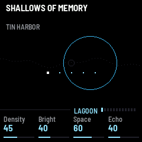

最初のページで、帰ってくる場所です。中ほどの線が水面で、音楽の状態をゆっくり描いています。光が多いと高く、
折り目があると荒れます。

- Density: 音楽にどれだけ詰まっているか。低いと音は少なく沈黙が長く、上げるほど増えます。
- Bright: 響きの明るさ。暗いほうから澄んだほうへ。
- Space: 音のまわりの広がり。
- Echo: テープのエコーがどれだけ戻ってくるか。

### 4.2 声

キットの声ごとに1ページ、全部で3つ。主旋律、応え、低音です。EDIT で主旋律、もう一度で次へ。ページには、声の
組み立て（CARRIER : MODULATOR、声を作る2つの音）、エンベロープ、声につれて開いたり閉じたりする輪が出ます。

- Color: 声の性格。素直で丸いものから、うつろなもの、鐘のようなもの、奇妙なものへ。（FM の比率です）
- Bright: 声がどれだけ輝くか。
- Decay: 打たれたあと、どれだけ鳴り残るか。
- Soft: 声の始まりのやわらかさ。低いと軽い一打、高いとゆっくりした膨らみ。（アタックです）

声には息のあるものがあります。音の横の空気、ざらついた揺れ、少しさまよう音程で、古びた、かすんだ感じになります。
これはキットが決めていて、SLOW BREATH と HAZE ARCHIVE には少し、DUST PIPES と FOG LANTERN と CHALK GARDEN には多く入っています。
AGE ページの Air で強さを変えられ、声のページにも出ます。声の手直しは、そのキットのものとして残ります。EDIT を
押し続けると、声がキットの元の音色に戻ります。

### 4.3 エフェクト

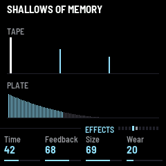

テープエコーとプレートです。どちらも AMB-1 から来ています。

- Time: テープのループの長さ。
- Feedback: エコーがどれだけ続くか。
- Size: プレートの部屋の大きさ。
- Wear: テープの古び。音全体も少しにじませます。本物のあとから遅れてさまよう、もうひとつの写しです。

### 4.4 AGE（かすれ）

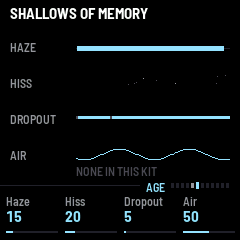

FX をもう一度押します。このページは、聞こえるものすべて、つまり声もエコーもプレートの上にかかります。

- Haze: 薄い膜。帯域が狭まり、大きい音が丸くなります。
- Hiss: 息をするような静かなノイズの床。鳴っている間だけあります。
- Dropout: ときどき、古いテープのように、音が薄く暗くなります。
- Air: 声の息。なしから、キットの2倍まで。50 でキットのままです。

### 4.5 環境

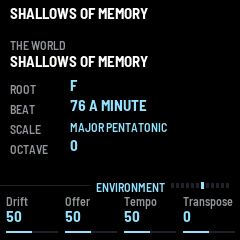

世界、その主音、拍、音階、オクターブが出ます。部屋のありようと、音楽がどこまで動かされてよいかを決めるページです。

- Drift: 周期と捧げものが、音楽をどこまで揺らすか。0 なら何も揺らさず、鍵盤もさざ波を立てません。
- Offer: 鍵盤の捧げもののしぶきの大きさ。
- Tempo: 速さ。
- Transpose: 音楽の調を上げ下げします。

### 4.6 周期

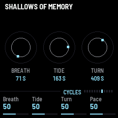

長さの違う3つのゆっくりした周期がいつも巡っていて、音楽は二度と同じにはなりません。呼吸（いちばん短く、
50〜100秒ほど）、潮（120〜230秒ほど）、長い周期（300〜600秒ほど）です。長さ自体もさまよいます。ページでは
それぞれが小さな印の回る軌道として描かれ、軌道の下に、いまの長さが秒で出ます。

- Breath、Tide、Turn（K1〜K3）: それぞれの周期が音楽をどれだけ揺らすか。
- Pace: 3つが回る速さ。

### 4.7 コード

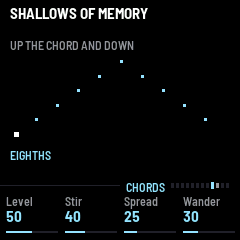

ARP を押します。音楽の下の分散和音で、キットの低音の声の音色で鳴ります。歩き方は世界ごとに違い、上り下り、
下りるだけ、飛び飛び、上がって途中まで落ちてまた上がる、振り子のよう、揺れる、ひと足とその影、のどれかです。

- Level: 音量。0 なら鳴りません。
- Stir: 音の粒立ち。世界の傾きによります。まばらな世界では長く響きます。
- Spread: 和音の幅。光があると高くまで届き、折り目があると狭まります。
- Wander: 歩き方と粒立ちが、音楽につれてどこまで動くか。0 なら世界のままです。

### 4.8 パルス

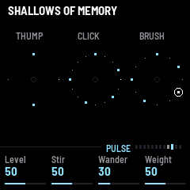

ARP をもう一度押します。くぐもった拍で、低い響き（thump）、小さなクリック、ブラシが、世界ごとのパターンに
乗ります。かすんだ脈にとどまり、踊らせるところへは行きません。低い響きは拍の上にだけ、1拍に多くて1つです。屋根裏の世界には低い響きがなく、小さなクリックとブラシだけです。階段の世界では、ゆっくりした低い響きと2つの小さなクリックがあり、ブラシはありません。

- Level: 音量。0 なら鳴りません。
- Stir: 打つ数が取られたり足されたりする量。
- Wander: パターンが音楽につれて動く量。0 なら動きません。
- Weight: 低い響きを、クリックとブラシに対してどれだけ重くするか。

コードもパルスも、音楽の沈黙を守ります。長い休みでは消え、手紙の世界ではすっかり消えます。鳴っている音を
途中で切ることもありません。

### 4.9 記憶

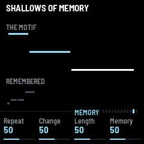

音楽が抱えているもの。モチーフと覚えているモチーフ、コード、ループ、手紙の行、噴水の音型、屋根裏の鍵、階段の中心です。ノブの意味は
世界によって変わります。屋根裏の世界ではページの見出しが THE KEYS、階段の世界では THE STAIR になります。

- Repeat: モチーフの音がひとつ来る、または去るまでに何度通すか、そして完成したまま何度通すか。行を読み直す回数。噴水が音型を変えうるまでに何周するか。屋根裏の一続きの吹き寄せの数。階段の中心が動きうるまでの歩みの数。
- Change: モチーフが完成している間に音がひとつ動く。語が入れ替わる。音型の高さ、足元、長さ、始まり。続きの合間に鍵がひとつ変わる。階段の中心が動く（影が反対側に回ることもあります）。
- Length: モチーフ、行、音型の音数。ドローンの膨らみ。ループの長さ。吹き寄せひとつの打つ数。階段のいちばん長いフレーズ。
- Memory: 昔のモチーフ、行、音型、鍵の組、中心が戻ってくる頻度。

SEQ を押し続けると音楽を留めます。新しいモチーフ、コード、行、音型、鍵、中心、音階は生まれず、すでに動いている変化は続きます。
もう一度押し続けると手放します。

### 4.10 全体

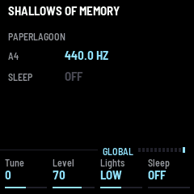

- Tune: 全体の調律。ページには A4 の高さで出ます。
- Level: すべての音量。
- Lights: ボタンの光の強さ。
- Sleep: 休むまでの分数。設定していないときは OFF と出ます。最後の1分は夕暮れです（「縁」を参照）。

---

## 5. 鍵盤と捧げもの

鍵盤は音を鳴らしません。鳴るのは REC を押している間だけです。ふだんは、押すと何かを捧げ、押し続けるとさらに
少しずつ捧げます。

捧げものは見えない状態に入ります。状態は紙の言葉で名づけた4つの量、光（light）、滲み（bleed）、折り目（fold）、
余白（margin）で、機器の画面には決して出ません。これが音楽を傾け、3つのゆっくりした周期が回し続けています。
どの鍵がどれにどう触れるかは、音の高さと鍵盤の位置、それに偶然で決まります。ひとつの鍵がひとつのことをする
ことはありません。

画面はすぐに応えます。滴が水面へ落ちていきます。

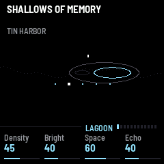

約0.4秒後に、滴が水面に触れ、輪が広がります。

その瞬間、音もすぐに揺れます。にじみ、暗くなったり澄んだりし、エコーとプレートがふくらみ、全体が少し静まったり
膨らんだりします。音楽はまもなく応え、一、二秒でその揺れは引きます。そのあと、捧げものは数秒かけて染み込み、
数分かけて消えていきます。変わるのは、音階、音域、休みの長さ、モチーフの長さ、応えと低音が来る頻度、
昔のモチーフが折り返して戻ること、ときには捧げた音を土台にしたモチーフです。屋根裏では、捧げた音の高さの鍵がひとつ掛かります。階段では、次の中心になります。

Drift が 0 なら揺れません。Offer が揺れの大きさを決めます。

---

## 6. 世界とキット

### 世界

ALGORITHM が世界を選びます。どれもどこにも存在しない場所で、それぞれ違うやり方で音楽を作ります。ノブにもキットにも
触れません。世界と一緒に画面も変わります。

- SHALLOWS OF MEMORY（記憶の浅瀬）: モチーフが、一度に音をひとつかふたつ、通るたびに書き込まれ、やがて完成します。
  完成したまま何度か聞こえ、通る合間に低音が下に添い、完成している間は応えが来ます。そのあと、通るたびに音をひとつかふたつ
  ずつ記憶から薄れ、何も残らなくなります。沈黙のあと、別のモチーフが書かれます。光はそれを持ち上げ、滲みは響かせ、
  余白は薄れを早めて沈黙を長くし、折り目は順序を乱して書きます。捧げものは次に書き込まれ、薄れている間は音をひとつ戻します。
- BEHIND THE HORIZON（水平線の裏側）: ドローン。和音が膨らんでは引き、その下に低い音があり、ときどき旋律が一音だけ
  来ます。
- THE UNREAD LETTER（誰も読まない手紙）: 離れた点がひとつずつ。手紙の語である数個の音が、前から跳んで、不規則な
  間で置かれます。一行ごとに長い沈黙。余白では、書かれても鳴らないままの音があります。
- THE FOUNTAIN AFTER CLOSING（閉園後の噴水）: 上がって下りる音型がひとつ、やわらかい8分音符でめぐり続け、ときどき少し
  変わります。

  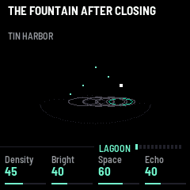
- WHERE LIGHT BECOMES MOSS（光が苔になるところ）: 長さの違う4本のループが、ずれながら重なります。
- THE ATTIC OF LOOSE KEYS（緩んだ鍵の屋根裏）: 5つの鍵（音の高さ）が、近く寄り合って高いところに掛かり、風の吹き寄せのたびに
  打たれます。吹き寄せは2〜10回、すばやく打ち、隣が隣にぶつかり（ときどき遠い鍵）、立ち上がっては消えていきます。
  吹き寄せの合間には数秒の静けさ。拍はありません。いくつかの吹き寄せのあとに、もっと長い凪があり、そのあと鍵がひとつ変わるか、
  新しい組が掛かります。強い吹き寄せには、深い音がひとつ下につくことがあります。捧げものは、その高さの鍵をひとつ掛け、
  その水しぶきがまもなく吹き寄せを呼びます。光は鍵を持ち上げ、滲みは響かせ、余白は屋根裏をいっそう静め、折り目は吹き寄せを
  荒くします。

  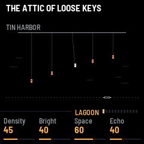
- A STAIR AND ITS SHADOW（階段とその影）: 声が2つ、ゆっくりと。階段は中心から離れては戻る歩みで、フレーズごとに
  前より1音長くなり（1音、2音、3音と、いちばん長いフレーズ、3〜7音まで）、どの音も長く伸びます。音ごとに影が鳴ります。
  根音の和音でいちばん近い音で、下に（変わったあとは上に、折り目のときは下と上を交互に）。2つが同じ高さで鳴ることは
  ありません。フレーズの合間に休みがあり、いちばん長いフレーズのあとは長い休み。そのあと階段は反対向きに回ります。
  根音が低く長く、歩みのたびに下にあります。捧げものは次の中心になり、光は中心を持ち上げ、滲みは音を響かせ、
  余白は休みを長くします。

  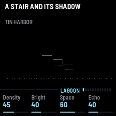

### キット

PRESETS でキットを選びます。主旋律、応え、低音の3つの声の組です。TIN HARBOR、WOODEN RAIN、GLASS ORCHARD、
SLOW BREATH、IRON SNOW、HAZE ARCHIVE、DUST PIPES、FOG LANTERN、CHALK GARDEN、BRASS EVENING
の10。コードは、キットの低音の声の音色で鳴ります。

---

## 7. 縁

こういう音楽は、カチッと始まったり止まったりしてはいけません。

### 渡り（crossing）

新しい世界を選ぶと、画面はすぐに変わりますが、音楽は変わりません。いまのフレーズをその場で終えます。数秒かかります。
その間、ノブの上の線とヘッダーに CROSSING と出て、世界の名前がゆっくり明滅し、ヘッダーの下を小さな航跡が流れます。
コードとパルスは消えていきます。それから一息おいて、新しい世界がまばらに開き、数秒かけて満ちていきます。

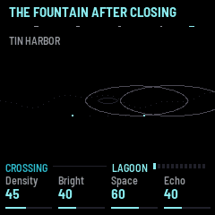

渡りの最中にもう一度選ぶと行き先が変わります。元の世界に戻せば、渡りは取りやめになります。

### 開く

PLAY を押すと、音楽はまばらに始まり、約25秒で満ちます。コードとパルスは数小節あとから入ります。

### 休みと、Sleep の夕暮れ

もう一度 PLAY を押すと、すぐに休みます。エコーとプレートは鳴り残ります。休んでいる間は世界の名前が灰色になり、
PLAY の光が鳴っているかどうかを示します。

Sleep を設定していると、最後の1分が夕暮れになります。まばらに、静かに、少し遅くなり、進むほどそうなって、
やがて休みます。

---

## 8. 保存

SAVE を押すと、すべてを保存します。世界、キット、ノブ、ページの設定。次に FM-1 を起動したときに戻ってきます。
保存していないものがあるあいだ、SAVE は光ったままです。声の手直しは、手を入れたキットのものとして残ります。

---

## 9. USB オーディオ

USB ケーブルをつなぐと、FM-1 はコンピューターのオーディオ入力として現れます。どんな録音ソフトでも、そこから
音楽を録音できます。

---

## 10. 困ったとき

音が出ないときは、全体ページの Level、PLAY が光っているか、Sleep の時間を確かめてください。休んだのかもしれません。
この音楽は長い沈黙を保つので、少し待ってみてください。

インストーラーが FM-1 を見つけないときは、Chrome か Edge を使い、ブラウザが尋ねたら MIDI を許可し、FM-1 の MIDI
ポートを使っているほかのプログラムを閉じてください。

M-VAVE 純正のファームウェアに戻すには、インストーラーの最後の項目で書き戻します。インストール後に FM-1 が起動
しないときは、2回起動に失敗するとセーフモードで立ち上がり、インストーラーから届きます。

---

## 11. ライセンス

PaperLagoon は GPL-3.0-only です。fm1-base（MPL-2.0）と felucca-bsp の上に作られていて、どちらも
Hügelton Instruments の Leo Kuroshita による Felucca に由来します。プレートとエコーは AMB-1（MPL-2.0）から
来ています。ソースは https://github.com/hacha/paperlagoon にあります。

M-VAVE と FM-1 はそれぞれの所有者の商標です。PaperLagoon は M-VAVE とは関係ありません。
