# PaperLagoon

[日本語](https://github.com/hacha/paperlagoon/blob/main/app/docs/MANUAL.ja.md)

PaperLagoon is a generative environmental-music firmware for the M-VAVE FM-1. It plays by itself. You don't play it; you
steer it from outside, the way you might change the light in a room. FM voices go through a tape echo and a plate
reverb, and a generator of phrases plays them, leaning on a hidden state that you can only touch from the side.

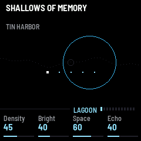

---

## Contents

1. Install
2. The screen
3. Controls
4. The pages
5. The keys and offerings
6. Worlds and kits
7. The edges
8. Saving
9. USB audio
10. Troubleshooting
11. Licence

---

## 1. Install

To try it first, open the emulator. It runs the same code in your browser, with sound.

To install it from the browser, use Chrome or Edge. Connect the FM-1 by USB, open the installer and press Install.
The browser asks once to allow MIDI, so allow it. Don't unplug the cable while it writes.

To install it from a terminal, run `python3 tools/fm1_install.py paperlagoon-VERSION.fwsc`, with the package that
goes with the version you downloaded.

You install it at your own risk. To go back to the stock firmware, use the installer's last section, which writes
M-VAVE's own firmware back.

---

## 2. The screen

At the top is the header. It holds the name of the world (on the lagoon and the voices' pages, the kit's name is
near it). While the world is changing, CROSSING shows at its right and on the rule (see The edges).

At the bottom are the four knobs, each with its name and its value. Above them runs a rule, and on the rule sits a
short strip: the name of the page you are on, and a row of small bars, one for each page, with the shown one lit.
It tells you where you are among the twelve pages. Turn SELECT to walk through them one by one, or press a button to
jump straight to its page.

Between the two is the page itself: water, an envelope, a ring, a path. It is a picture of what the page is about
and it moves as the music moves. When the music rests, the world's name is greyed, and the PLAY button shows
whether it is playing.

Every button glows dim. The one whose page is shown is lit. PLAY is lit while it plays, SAVE when something is not
saved, SEQ while it is held, ARP while the chords or the pulse sound, and OCT when the register has been moved.
Lights, on the global page, sets how bright they all are.

---

## 3. Controls

| Control | What it does |
| --- | --- |
| SELECT | Turns through the twelve pages, in order. |
| HOME | Goes to the lagoon. Lit there. |
| EDIT | Goes to the voices. Press again for the next voice. Hold it to put the voice back as the kit has it. |
| FX | Goes to the effects. Press again for the age. Press again to go back. |
| ENV | Goes to the environment: the world, its root, its beat, its scale. |
| LFO | Goes to the cycles. |
| GLO | Goes to the global page. |
| ARP | Goes to the chords. Press again for the pulse. Press again to go back. |
| SEQ | Goes to the memory. Hold it to hold the music still, hold it again to let go. |
| OCT− · OCT+ | Move the register of the music, two octaves either way. While REC is held they move the keys' octave instead. |
| REC | Hold it and the keys play, and the music waits. Let go, and what you played is taken in as the music's own, in whatever way the world holds it. |
| SEL | Hold it and K1 to K4 are the lagoon's four knobs, on any page. On the lagoon itself, they turn in finer steps. |
| PRESETS | Picks the kit. Ten kits, each three voices. Edits to the voices are kept per kit. |
| ALGORITHM | Picks the world. Seven worlds. The change is a crossing. |
| K1 to K4 | The four knobs of the page that is shown. |
| PLAY | Plays, or rests. |
| SAVE | Keeps everything. Lit when something is not saved. |
| Keys | Play no notes. A press offers something to the music. |

---

## 4. The pages

There are twelve. The four knobs always belong to the page you are on, and they do what they say, plainly. The
music's hidden state leans how the music goes, but it never turns the knobs.

### 4.1 The lagoon

The first page, and the one to come home to. The line across the middle is the water. It is the state of the music,
drawn slowly: higher when there is light in it, rougher when it is folded.

- Density: how much there is in the music. At the bottom, few notes and long silences; higher, more.
- Bright: how clear and open it sounds, from dark to bright.
- Space: how much of the plate's room is around it.
- Echo: how much of the tape's echo comes back.

### 4.2 The voices

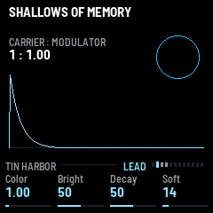

Three pages, one for each voice of the kit: the lead, the answer and the low voice. EDIT goes to the lead, and again
to the next. The page shows the voice's make-up (CARRIER : MODULATOR, the two tones the voice is built from), its
envelope, and a ring that opens and closes with the voice.

- Color: the voice's character, from plain and round to hollow, bell-like or strange.
- Bright: how much of the voice shines.
- Decay: how long the voice rings after it is struck.
- Soft: how gently the voice begins. Low is a tap, high is a slow swell.

Some voices have breath: air beside the tone, a rough wobble, a pitch that wanders a little, as if worn or hazy. The
kit fixes it. There is a little in SLOW BREATH and HAZE ARCHIVE and much in DUST PIPES, FOG LANTERN and CHALK GARDEN. Air, on the
age page, scales it, and the voice's page shows it. Edits to a voice are kept for that kit. Hold EDIT to put the
voice back as the kit has it.

### 4.3 The effects

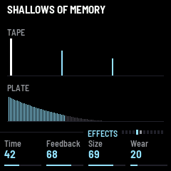

The tape echo and the plate.

- Time: the length of the tape's loop.
- Feedback: how long the echoes go on.
- Size: how large the plate's room is.
- Wear: how old the tape is. It also blurs the whole sound a little: a late, wandering copy beside the real one.

### 4.4 The age

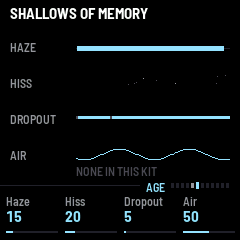

Press FX again. This page lies over everything that you hear, voices, echoes and plate.

- Haze: a veil. The band narrows and the loud parts round off.
- Hiss: a floor of soft noise that seems to breathe. It is there only while the music plays.
- Dropout: now and then the sound thins and darkens for a moment, as worn tape does.
- Air: the breath of the voices, from none to twice what the kit gives. At 50 the kit is as it was made.

### 4.5 The environment

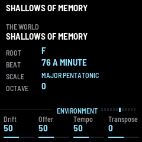

The page shows the world, its root note, its beat, its scale and the octave. It is where you set how the room
lies, and how far the music is allowed to be moved.

- Drift: how far the cycles and the offerings (what a key gives; see 5. The keys and offerings) sway the music. At 0 nothing sways it, and the keys stir nothing.
- Offer: how great the stir of an offering from the keys is.
- Tempo: how fast it goes.
- Transpose: the music's key, moved up or down.

### 4.6 The cycles

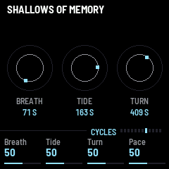

Three slow cycles of unequal length turn all the time, and so the music is never quite the same twice. They are the
breath (the shortest, about 50 to 100 seconds), the tide (about 120 to 230 seconds) and the long turn (about 300 to
600 seconds). Their lengths wander too. The page draws each as an orbit with a small mark going round it.

- Breath, Tide, Turn (K1 to K3): how deeply each cycle sways the music.
- Pace: how fast all three go round. Under each orbit the page shows the length its cycle has at the moment, in
  seconds.

### 4.7 The chords

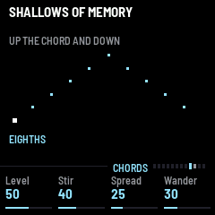

Press ARP. Broken chords under the music, played in the colour of the kit's low voice. Each world walks its chord
in its own way: up and down, falling, scattered, rising and falling back, like a pendulum, swaying, or a step and its shadow.

- Level: how loud. At 0 there are none.
- Stir: the grain of the notes. As the world leans it; a sparse world rings long.
- Spread: how wide the chord reaches. Light lifts it higher, and a fold draws it in.
- Wander: how far the walk and its grain move with the music. At 0 it is the world's own.

### 4.8 The pulse

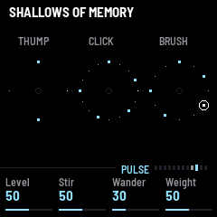

Press ARP again. A muffled beat: a low thump, a small click and a brush, laid on each world's own patterns. Some worlds leave one or two of these out. It stays
a hazy pulse, and never goes to a dance. The thump stays on the beats, at most one to a beat.

- Level: how loud. At 0 there is none.
- Stir: how many hits are taken away or added.
- Wander: how far the patterns move with the music. At 0 they keep still.
- Weight: how much the thump counts against the click and the brush.

The chords and the pulse both keep the silences of the music. In a long rest they fade, in some worlds
wholly. They never cut off a note that is sounding.

### 4.9 The memory

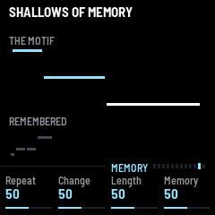

What the music holds: a motif, a chord, a line, a figure, whatever the world plays from. What it is, and so what
each knob touches, depends on the world, and on some the page has its own heading. 6. Worlds and kits tells what each
world holds.

- Repeat: how many times it is played before it may change.
- Change: how much changes when it does.
- Length: how long it is.
- Memory: how often an older one comes back.

Hold SEQ to hold the music: nothing new is taken up, and the scale stays. The changes already moving go on. Hold SEQ
again to let go.

### 4.10 The global page

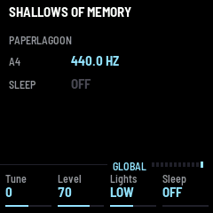

- Tune: the tuning of the whole; the page shows it as the pitch of A4.
- Level: the volume of everything.
- Lights: the glow of the buttons.
- Sleep: minutes until it rests; the page says OFF when it is not set. Its last minute is a dusk (see The edges).

---

## 5. The keys and offerings

The keys play no notes. Only under REC do they play. Otherwise a press offers something, and a held key offers a
little more, again and again.

The offering goes to the hidden state. It has four quantities, named for paper: light, bleed, fold and margin. You
never see them on the device. They lean the music, and three slow cycles keep turning them. Which one a key
touches, and how, depends on its pitch and its place on the keyboard, a part of it fixed and a part of it left to
chance. No key does one fixed thing.

The screen answers at once: a drop falls toward the water.

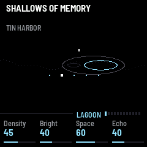

About 0.4 seconds later the drop meets the water, and the rings spread.

At that moment the sound stirs too, at once. It smears, turns darker or clearer, the echoes and the plate swell, the
whole is a little hushed or a little swollen. The music answers soon after, and in a second or two the stir is gone.
Then the offering seeps in over some seconds, and it fades over minutes. What it changes is the scale, the register,
the length of the rests, how long a motif is, how often the answer and the low voice come, an older motif folding
back, and now and then a motif built on the pitch you offered. In some worlds an offering does something of its own
as well (see 6. Worlds and kits).

With Drift at 0 nothing stirs. Offer sets how great the stir is.

---

## 6. Worlds and kits

### The worlds

ALGORITHM picks the world. Each is a place that exists nowhere, and each makes music in its own way. They never
touch the knobs or the kit. The screen changes with the world.

- SHALLOWS OF MEMORY: a motif is written in a note or two each pass, until it is whole. It is heard whole a few times:
  the low voice under a pass now and then, the answer while it is whole. Then it fades from memory a note or two each
  pass, until nothing is left. After a silence another is written. Light lifts it and bleed lets it ring. An offering is written in next; while a motif
  fades, it puts a note back. In the margin the washing away is faster and the silences longer, and a fold writes the
  motif out of order.
- BEHIND THE HORIZON: a drone. Chords swell and fall back, a low tone lies under them, and now and then one note of a
  melody comes.
- THE UNREAD LETTER: single points, far apart. A few pitches, the letter's words, each a leap from the last, at
  uneven distances. A long silence follows each line. In the margin some stay unread, written but not sounded.
- THE FOUNTAIN AFTER CLOSING: one figure that rises and falls back, round and round in soft eighths, changing a little now and
  then.

  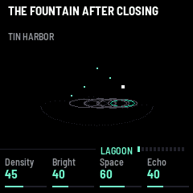
- WHERE LIGHT BECOMES MOSS: four loops of unequal length, drifting in and out of step.
- THE ATTIC OF LOOSE KEYS: five keys hanging close together, high, struck in gusts. A gust strikes two to ten times,
  quickly, neighbour knocking neighbour (now and then one further off), rising and dying away. Between gusts there is a
  stillness of some seconds. No beat. After a spell of gusts comes a longer calm; then a key is changed, or a new set
  hangs. A strong gust may bring one deep tone under it. An offering hangs a key of its pitch, and its splash brings a
  gust soon. Light lifts the keys and bleed lets them ring. The page of the memory is called THE KEYS. In the margin the attic is still for longer, and a fold makes
  the gusts wilder.

  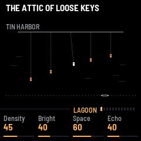
- A STAIR AND ITS SHADOW: two voices, slowly. The stair walks by steps away from a centre and back, each phrase one
  step longer than the last (one note, two, three, up to the longest, three to seven), each note long. With every
  note its shadow sounds: the nearest tone of the root's chord, under it (after a change, over it; in a fold it
  alternates). The two never sound the same pitch. A rest comes between phrases, a long one after the longest; then
  the stair turns the other way. The root, low and long, lies under each walk. An offering becomes the next centre,
  and light lifts the centre; bleed lets the notes ring. The page of the memory is called THE STAIR. In the margin the rests grow longer.

  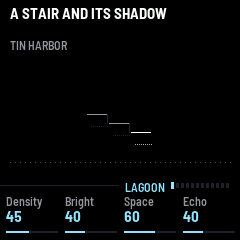

### The kits

PRESETS picks the kit, a set of three voices: a lead, an answer and a low voice. There are ten: TIN HARBOR,
WOODEN RAIN, GLASS ORCHARD, SLOW BREATH, IRON SNOW, HAZE ARCHIVE, DUST PIPES, FOG LANTERN, CHALK GARDEN and
BRASS EVENING. The chords take the
colour of the kit's low voice.

---

## 7. The edges

Music of this kind should not start or stop with a click.

### Crossing

When you pick a new world, the screen changes at once, but the music does not. It finishes its phrase where it is,
which takes a few seconds. The rule over the knobs and the header both say CROSSING, the name of the world breathes,
and a small wake runs under the header. The chords and the pulse fade. Then a breath, and the new world opens,
sparse, and fills out over some seconds.

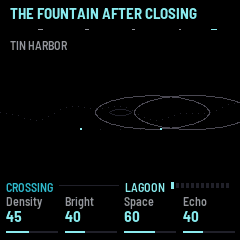

If you pick again during a crossing the way changes. If you go back to the world you left, the crossing is
cancelled.

### Opening

When you press PLAY, the music begins sparse and is full in about 25 seconds. The chords and the pulse come in a few
bars after.

### Resting, and Sleep's dusk

Press PLAY again and it rests at once. The echoes and the plate ring on. While it rests the world's name is greyed,
and PLAY's light shows whether it is playing.

When Sleep is set, its last minute is a dusk: sparser, quieter, a little slower, and more so as it goes. Then it
rests.

---

## 8. Saving

Press SAVE to keep everything: the world, the kit, the knobs, the pages' settings. They come back the next time the
FM-1 starts. SAVE stays lit while something is not saved. Edits to a voice are kept for the kit they were made in.

---

## 9. USB audio

Over the USB cable the FM-1 appears as an audio input on your computer. You can record the music from it, with any
recorder.

---

## 10. Troubleshooting

If you hear nothing, check the Level on the global page, that PLAY is lit, and the Sleep time: it may have rested.
The music also keeps long silences, so wait a little.

If the installer doesn't find the FM-1, use Chrome or Edge, allow MIDI when the browser asks, and close any other
programs that use the FM-1's MIDI port.

To go back to M-VAVE's own firmware, use the installer's last section, which writes it back. If the FM-1 doesn't
start after an install, it starts in a safe mode after two failed starts, and the installer can reach it from there.

---

## 11. Licence

PaperLagoon is GPL-3.0-only. It is built on fm1-base (MPL-2.0) and felucca-bsp, which come from Felucca by Leo
Kuroshita, Hügelton Instruments. The plate and the echo come from AMB-1 (MPL-2.0). The source is at
https://github.com/hacha/paperlagoon.

M-VAVE and FM-1 are trademarks of their owners. PaperLagoon is not affiliated with M-VAVE.
