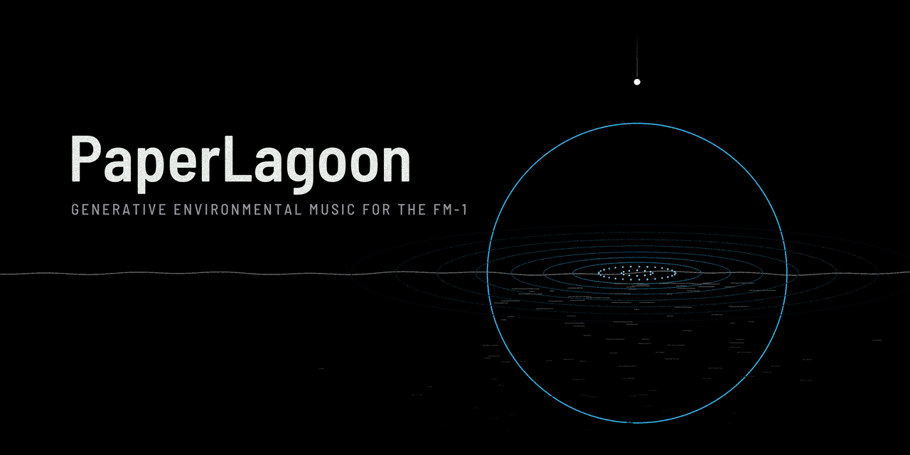

# PaperLagoon

PaperLagoon is a generative environmental-music firmware for the M-VAVE FM-1. It plays by itself, and you steer it from outside. The keys play no notes: a press offers something to a
hidden state, a drop falls to the water, and the music answers, loosely, and then more slowly. Five worlds that exist
nowhere, eight kits of FM voices, a tape echo and a plate, and a few slow cycles that keep it turning.

This is version {{VERSION}}. You install it at your own risk, and the installer can put M-VAVE's own firmware back.

- [Try it in the browser](emu/). Play it right here, with sound. It runs the same code as the FM-1, so you don't
  need one.
- [Install](install/) it from Chrome or Edge, with the FM-1 connected by USB.
- The [Manual](manual/) explains the screen, the pages, the keys and offerings, the worlds and the kits.
- [Download {{PKG}}](firmware/{{PKG}}) to use the command-line installer: `python3 tools/fm1_install.py {{PKG}}`.
- The [Source](https://github.com/hacha/paperlagoon) is under GPL-3.0-only. It's built on fm1-base (MPL-2.0) and
  felucca-bsp, which come from Felucca by Leo Kuroshita, Hügelton Instruments. The plate and the echo come from
  AMB-1 (MPL-2.0).

M-VAVE and FM-1 are trademarks of their owners. PaperLagoon is not affiliated with M-VAVE.

日本語: FM-1 のための、自動生成の環境音楽ファームウェアです。鍵盤は音を鳴らさず、
押すと音楽に何かを捧げます。使い方は[日本語のマニュアル](https://github.com/hacha/paperlagoon/blob/main/app/docs/MANUAL.ja.md)をご覧ください。
